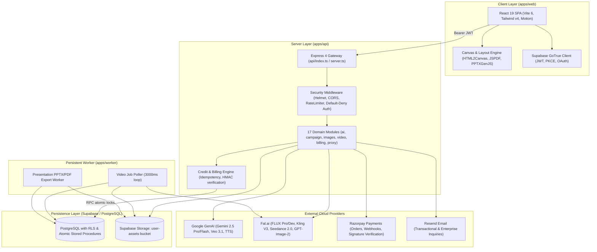
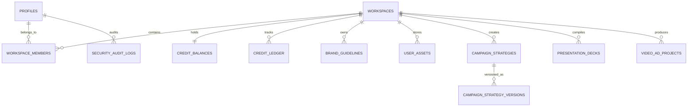

# Product Requirements Document (PRD): Writopedia Enterprise Creative Suite

**Document Version**: `1.0.0`  
**Repository**: `DavePujan/master-enterprise-creative-suite`  
**Git Commit Revision**: `913d538`  
**Current Active Branch**: `feature/campaign-strategy-modernization`  
**Date of Audit**: October 2026  
**Status**: `Complete from available repository evidence`  

---

## 1. Metadata & Executive Summary

### 1.1 Executive Summary
Writopedia Enterprise Creative Suite is a full-stack, multimodal creative automation platform and AI brand engine. Powered by Google Gemini 2.5 (Pro/Flash), Google Veo 3.1, Google Imagen, and Fal.ai (FLUX Pro/Schnell, Kling 3.0, ByteDance Seedance 2.0), the platform enables enterprises, agencies, and brand managers to:
1. Initialize brand identities and guidelines with automated color palette, tone, typography, and logo extraction.
2. Plan and synthesize 16-dimension enterprise campaign strategies through a structured 5-stage strategic journey.
3. Generate coordinated multi-channel visual assets, copywriting, voiceovers, music soundtracks, and cinematic video commercials.
4. Author data-grounded corporate slide decks with automated Google Search validation and PowerPoint (PPTX) export.
5. Direct complex multi-shot video commercials via a formal 10-phase Video AdDirector production architecture.
6. Execute credit-based compute operations governed by a server-authoritative, atomic billing ledger with Razorpay checkout integration.

### 1.2 Evidence & Classification Standard
Every architectural, functional, and operational statement in this PRD is labeled with one of the following evidence tiers:
* **`[Verified]`**: Backed by direct repository evidence in source code, database migrations, configuration manifests, or test suites.
* **`[Inferred]`**: Logical architectural deduction derived from code structures, convention patterns, or UI states.
* **`[Proposed]`**: Documented roadmap specification or recommendation not yet activated in the active codebase.
* **`[Unknown]`**: Cannot be definitively established from repository inspection alone.

---

## 2. Vision, Business Goals, Outcomes & Scope

### 2.1 Product Vision `[Verified]`
To empower enterprise marketing teams and creative agencies to produce cohesive, on-brand, high-fidelity commercial creative campaigns in minutes rather than weeks, replacing disconnected tools with a unified, brand-grounded workspace.

### 2.2 Commercial Model & Economic Baseline `[Verified: docs/TOKEN_USAGE.md, docs/PRICING.md]`
* **Dual-Currency Financial Model**: USD ($) and INR (₹), standardized at `$1.00 USD = ₹93.00 INR`.
* **Gross Margin Target**: Generative operations maintain **65% to 85%+ gross profit margin** across all creative modalities after third-party compute (Google GenAI, Fal.ai) and payment gateway processing fees.
* **Effective Credit Valuation**:
  - Starter / On-Demand: ₹15.00 / $0.17 per Credit
  - Growth / Plus: ₹12.50 / $0.13 per Credit
  - Enterprise / Pro: ₹10.00 / $0.10 per Credit

### 2.3 Non-Goals `[Inferred]`
* **Autonomous Social Media Auto-Poster**: The suite generates platform-ready creatives, captions, and videos, but does not autonomously publish to third-party social APIs (e.g., Meta Graph API, TikTok API, X API).
* **Raw Code Generator**: The suite produces brand assets and strategy documents, not web source code or mobile software applications.
* **Free Compute Provider**: Generative compute is strictly gated behind credit reservations; unauthenticated or zero-credit requests are rejected at the API boundary.

---

## 3. Stakeholders, Personas & Permission Model

### 3.1 Primary Personas `[Inferred from UI and Feature Slices]`

| Persona | Role | Primary Jobs to be Done | Key Workspace Features Used |
| :--- | :--- | :--- | :--- |
| **Creative Director** | Agency Lead | Define visual brand guidelines, review strategic routes, orchestrate 5-asset campaign decks | Brand Kit, Campaign Strategist, AdDirector Studio |
| **Performance Marketer** | Growth Lead | Generate high-converting social captions, video ads for TikTok/Reels, A/B ad variations | Captions & Copywriting, Cinematic Video, Ecommerce Bundle |
| **Brand Manager** | Enterprise In-House | Ensure brand consistency across color palettes, tone, typography, and logo placements | Brand Guidelines Drawer, Interactive Canvas, DAM Library |
| **Executive / Consultant**| Management Lead | Compile data-grounded corporate pitch decks and strategy briefs for board presentations | Corporate Presentations (Google Search Grounding, PPTX export) |

### 3.2 Role-Based Access Control (RBAC) Matrix `[Verified: 20260903000003_row_level_security.sql, authMiddleware.ts]`

| Role Identifier | Authentication Method | Workspace Access | Administrative Access | Credit Mutation Privileges |
| :--- | :--- | :--- | :--- | :--- |
| **Anonymous (T1)** | None | Public routes only (`/`, `/login`, `/pricing`, `/legal/*`) | None | None |
| **Member (T2)** | Supabase JWT (Email / Google) | Access to own personal/team workspace | None | Deduct on generation, purchase booster |
| **Workspace Admin (T4)** | Supabase JWT | Manage workspace members, view usage ledger | None | Purchase subscription, invite seats |
| **System Admin (T7)** | Verified `public.user_roles` | Full platform access, curation fulfillment | Full (`/admin`, `/api/admin/*`) | View system telemetry, audit logs |

---

## 4. System Context & Architecture

---

## 5. Feature Inventory & Creative Modalities

### 5.1 Creative Gems Registry `[Verified: apps/web/src/infrastructure/ai/modelRegistry.ts]`

| Gem ID | Display Name | Modality | Standard Cost | Primary AI Provider / Engine | Key Capabilities |
| :--- | :--- | :--- | :---: | :--- | :--- |
| `campaign-strategist-y` | Campaign Strategy | Strategy / Text | **5c** | `gemini-2.5-pro` | 16-dimension strategy, 5-stage journey, territory routes |
| `bundles-campaigns` | Ecommerce Bundle | Multi-Asset Deck | **25c** | 5x `openai/gpt-image-2` + `gemini-2.5-pro` | Coordinated 5-asset visual pack (16:9, 1:1, 3:4) |
| `strategy-captions` | Captions & Copy | Text | **1c / 2c** | `gemini-2.5-flash` / `gemini-2.5-pro` | Multi-platform copy (Instagram, LinkedIn, X, Threads) |
| `standard-image` | Standard Brand Image | Image | **2c – 4c** | `fal-ai/flux/schnell`, `fal-ai/flux/dev`, Gemini | High-res commercial product shots, brand palette lock |
| `cinematic-video` | Cinematic & Social Video | Video | **10c – 80c** | Google Veo 3.1 (Lite/Fast/Pro), Kling 3.0, Seedance | 720p/1080p/4K motion promos, keyframe interpolation |
| `audio-studio` | Voiceover & Audio Studio | Audio | **2c – 6c** | `gemini-2.5-flash-preview-tts` | Speakable voiceovers (multi-accent) & music tracks |
| `corporate-presentations` | Corporate Presentations | Presentation | **5c** | `gemini-2.5-pro` | Multi-slide structured decks, live search grounding, PPTX |
| `brand-narrative-storyline` | Storyline Generator | Image Series | **15c** | `fal-ai/flux/dev` | 6-8 scene progressive visual storytelling narrative |

---

## 6. Functional Requirements

### 6.1 Authentication & User Lifecycle

#### `FR-001`: Email & Password Registration with Hardened Policy `[Verified]`
* **Statement**: The platform shall allow users to register an account using an email address, password, and optional full name.
* **Evidence**: [`apps/web/src/features/auth/components/AuthBox.tsx:72-109`](file:///c:/zz_ALL/z_Project/Writopedia/apps/web/src/features/auth/components/AuthBox.tsx), [`apps/web/src/infrastructure/supabase/auth.ts:101-131`](file:///c:/zz_ALL/z_Project/Writopedia/apps/web/src/infrastructure/supabase/auth.ts).
* **Acceptance Criteria**:
  - **Given** a user registering on `/login` (Sign Up tab),
  - **When** they enter a password with fewer than 8 characters,
  - **Then** the form blocks submission with `"Password must be at least 8 characters."`
  - **When** they enter a blacklisted common password (e.g. `password123`, `12345678`),
  - **Then** the form blocks submission with `"This password is too common or easily guessed. Please choose a more secure password or passphrase."`
  - **When** they enter a password up to 128 characters without rigid symbol/number constraints,
  - **Then** the submission proceeds successfully.

#### `FR-002`: Confirm Password Field on Registration `[Verified]`
* **Statement**: The Sign Up form shall require a Confirm Password field with real-time matching verification.
* **Evidence**: [`apps/web/src/features/auth/components/AuthBox.tsx:356-410`](file:///c:/zz_ALL/z_Project/Writopedia/apps/web/src/features/auth/components/AuthBox.tsx).
* **Acceptance Criteria**:
  - **Given** a user entering a password in the Sign Up form,
  - **When** they enter a non-matching value in Confirm Password,
  - **Then** the UI displays an inline rose warning `"Passwords do not match"` and disables the submit CTA.
  - **When** Confirm Password matches exactly,
  - **Then** the UI displays an emerald indicator `"Passwords match"` with a checkmark icon.

#### `FR-003`: Visual Password Strength Indicator `[Verified]`
* **Statement**: The Sign Up form shall display a dynamic 4-segment visual strength indicator as user guidance.
* **Evidence**: [`apps/web/src/features/auth/components/AuthBox.tsx:348-385`](file:///c:/zz_ALL/z_Project/Writopedia/apps/web/src/features/auth/components/AuthBox.tsx).
* **Acceptance Criteria**:
  - **Given** a dirty password field during registration,
  - **Then** the UI updates a 4-bar indicator categorized as:
    - 1 bar (Rose): `Weak`
    - 2 bars (Amber): `Fair`
    - 3 bars (Emerald): `Good`
    - 4 bars (Teal): `Strong`

#### `FR-004`: Email Verification Quarantine `[Verified]`
* **Statement**: Unconfirmed accounts shall be quarantined at `/verify-email` and prevented from accessing workspaces.
* **Evidence**: [`apps/web/src/app/AppRouter.tsx:104-110`](file:///c:/zz_ALL/z_Project/Writopedia/apps/web/src/app/AppRouter.tsx), [`apps/web/src/features/auth/components/VerifyEmailView.tsx`](file:///c:/zz_ALL/z_Project/Writopedia/apps/web/src/features/auth/components/VerifyEmailView.tsx).
* **Acceptance Criteria**:
  - **Given** an authenticated user whose email is not confirmed,
  - **When** they attempt to navigate to `/workspace`, `/assets`, or `/settings`,
  - **Then** the router immediately redirects them to `/verify-email` with options to resend the confirmation link.

---

### 6.2 Brand Kit & Identity Initialization

#### `FR-005`: Brand Guidelines Extraction & Storage `[Verified]`
* **Statement**: The platform shall extract brand identity parameters from text briefs or URLs and persist them to PostgreSQL.
* **Evidence**: [`apps/web/src/features/brand-guidelines/components/BrandSetup.tsx`](file:///c:/zz_ALL/z_Project/Writopedia/apps/web/src/features/brand-guidelines/components/BrandSetup.tsx), [`apps/api/src/modules/brand/brandRoutes.ts`](file:///c:/zz_ALL/z_Project/Writopedia/apps/api/src/modules/brand/brandRoutes.ts).
* **Acceptance Criteria**:
  - **Given** a brand initialization brief,
  - **When** processed by the AI extraction engine,
  - **Then** the system outputs a typed `BrandGuidelines` record containing brand name, industry, tone, strategic pillars, color palettes (hex values), typography, and location parameters.

#### `FR-006`: Logo Handling & Anti-Hallucination Invariant `[Verified: docs/PIPELINE.md:80-82]`
* **Statement**: Generative image models shall be strictly instructed not to hallucinate logos or misspelled text; authentic brand logos shall be rendered as overlays via the client canvas layer.
* **Evidence**: [`apps/web/src/features/canvas/components/InteractiveLogoOverlay.tsx`](file:///c:/zz_ALL/z_Project/Writopedia/apps/web/src/features/canvas/components/InteractiveLogoOverlay.tsx), [`apps/web/src/infrastructure/ai/modelRegistry.ts:333-339`](file:///c:/zz_ALL/z_Project/Writopedia/apps/web/src/infrastructure/ai/modelRegistry.ts).

---

### 6.3 Campaign Strategist 2.0 & Multi-Channel Workspaces

#### `FR-007`: 5-Stage Campaign Strategy Journey `[Verified]`
* **Statement**: The Campaign Strategist Gem shall orchestrate campaigns across 5 sequential stages: Brief & Discovery (`01_brief`), Strategic Territories (`02_territory`), Master Strategy Synthesis (`03_strategy`), Downstream Deliverables (`04_deliverables`), and Final Activation (`05_activate`).
* **Evidence**: [`apps/web/src/features/campaigns/components/CampaignStrategistWorkspace.tsx:180-250`](file:///c:/zz_ALL/z_Project/Writopedia/apps/web/src/features/campaigns/components/CampaignStrategistWorkspace.tsx), [`packages/types/campaignStrategy.ts`](file:///c:/zz_ALL/z_Project/Writopedia/packages/types/campaignStrategy.ts).

#### `FR-008`: Versioned Campaign Persistence & Rehydration `[Verified]`
* **Statement**: Saved campaign strategies shall persist in PostgreSQL across versions, support preview drawers, and reload into the active workspace without data loss.
* **Evidence**: [`apps/api/src/modules/campaigns/campaignRepository.ts:50-130`](file:///c:/zz_ALL/z_Project/Writopedia/apps/api/src/modules/campaigns/campaignRepository.ts), [`apps/web/src/features/campaigns/components/modals/SavedStrategiesModal.tsx`](file:///c:/zz_ALL/z_Project/Writopedia/apps/web/src/features/campaigns/components/modals/SavedStrategiesModal.tsx).
* **Acceptance Criteria**:
  - **Given** a user opening the Saved Strategies Manager modal,
  - **When** strategies are displayed,
  - **Then** each item renders a valid human-readable date (`Saved Oct 09, 2026 · 04:58 PM`), a calculated stage status badge (e.g. `Stage 5/5 · Activation Ready`), and a short ID hash (e.g. `#E00F`).
  - **When** the user clicks "Load strategy",
  - **Then** the strategy rehydrates into the workspace and lands on the appropriate stage without 404 errors.

#### `FR-009`: Ecommerce 5-Asset Coordinated Bundle `[Verified]`
* **Statement**: The Ecommerce Bundle Gem shall generate five brand-cohesive visual assets in parallel matching strict aspect ratios: Hero (16:9), Macro Closeup (1:1), Lifestyle (3:4), Offer (1:1), and Alternate (1:1).
* **Evidence**: [`apps/api/src/modules/campaigns/bundleOrchestratorService.ts`](file:///c:/zz_ALL/z_Project/Writopedia/apps/api/src/modules/campaigns/bundleOrchestratorService.ts), [`apps/web/src/features/campaigns/components/CampaignDeckWorkspace.tsx`](file:///c:/zz_ALL/z_Project/Writopedia/apps/web/src/features/campaigns/components/CampaignDeckWorkspace.tsx).

---

### 6.4 Video Generation & AdDirector Studio

#### `FR-010`: Multimodal Video Generation `[Verified]`
* **Statement**: The platform shall dispatch asynchronous video jobs supporting text-to-video, image-to-video, keyframe motion interpolation, and reference conditioning across Google Veo, Kling V3, and Seedance 2.0.
* **Evidence**: [`apps/api/src/modules/videoGeneration/videoGenerationService.ts`](file:///c:/zz_ALL/z_Project/Writopedia/apps/api/src/modules/videoGeneration/videoGenerationService.ts), [`packages/contracts/modelCapabilityContracts.ts`](file:///c:/zz_ALL/z_Project/Writopedia/packages/contracts/modelCapabilityContracts.ts).

#### `FR-011`: 10-Phase Video AdDirector Production Architecture `[Verified]`
* **Statement**: The AdDirector module shall support an end-to-end commercial production pipeline: Discovery Ingestion -> Brief Reconciliation -> Creative Concepts -> Director's Plan -> Patch Revision -> Prompt Compilation -> Provider Adapters -> Queue Execution -> Video QA Evaluation -> Video Assembly & Export.
* **Evidence**: [`apps/api/src/modules/adDirector/adDirectorRoutes.ts`](file:///c:/zz_ALL/z_Project/Writopedia/apps/api/src/modules/adDirector/adDirectorRoutes.ts), [`packages/ad-director/`](file:///c:/zz_ALL/z_Project/Writopedia/packages/ad-director/).

---

### 6.5 Presentations, Audio & Additional Gems

#### `FR-012`: Corporate Presentation Decks with Search Grounding `[Verified]`
* **Statement**: Corporate presentation generation shall produce structured slides validated against real-world industry facts via Google Search Grounding and export to PowerPoint `.pptx` format.
* **Evidence**: [`apps/api/src/modules/presentation/presentationService.ts`](file:///c:/zz_ALL/z_Project/Writopedia/apps/api/src/modules/presentation/presentationService.ts), [`packages/presentation-engine/`](file:///c:/zz_ALL/z_Project/Writopedia/packages/presentation-engine/).

#### `FR-013`: Audio Studio Voiceovers & Music Tracks `[Verified]`
* **Statement**: The audio studio shall generate speakable voiceovers with accent and emotion control via Gemini Flash TTS and custom background music tracks.
* **Evidence**: [`apps/api/src/modules/audioGeneration/audioRoutes.ts:18-80`](file:///c:/zz_ALL/z_Project/Writopedia/apps/api/src/modules/audioGeneration/audioRoutes.ts), [`packages/types/audioGeneration.ts`](file:///c:/zz_ALL/z_Project/Writopedia/packages/types/audioGeneration.ts).

---

### 6.6 Server-Authoritative Billing & Credit Fulfillment

#### `FR-014`: Atomic Two-Phase Credit Reservation `[Verified]`
* **Statement**: Before executing any generative model call, the server shall atomically reserve the required credits in PostgreSQL. If the generation fails or is aborted, the reservation shall be released automatically.
* **Evidence**: [`supabase/migrations/20260903000002_hardened_functions_and_procedures.sql:1-85`](file:///c:/zz_ALL/z_Project/Writopedia/supabase/migrations/20260903000002_hardened_functions_and_procedures.sql), [`apps/api/src/services/creditService.ts`](file:///c:/zz_ALL/z_Project/Writopedia/apps/api/src/services/creditService.ts).

#### `FR-015`: Razorpay Order Creation & HMAC Verification `[Verified]`
* **Statement**: Credit purchases via subscriptions or booster packs shall execute server-side Razorpay order registration and cryptographic HMAC-SHA256 signature verification.
* **Evidence**: [`apps/api/src/modules/billing/billingRoutes.ts:68-150`](file:///c:/zz_ALL/z_Project/Writopedia/apps/api/src/modules/billing/billingRoutes.ts), [`apps/api/src/infrastructure/payment/razorpayClient.ts`](file:///c:/zz_ALL/z_Project/Writopedia/apps/api/src/infrastructure/payment/razorpayClient.ts).
* **Acceptance Criteria**:
  - **Given** a checkout payment completed on Razorpay,
  - **When** `POST /api/payment/razorpay-verify` is submitted,
  - **Then** the server computes HMAC-SHA256(`order_id + "|" + payment_id`, `RAZORPAY_KEY_SECRET`) and compares it timing-safely.
  - **When** signatures match, credits are granted atomically and the transaction is recorded in `payment_transactions` to prevent duplicate replay fulfillment.

---

## 7. Data Model & Persistence Architecture

### 7.1 Schema Overview & Multi-Tenancy `[Verified: supabase/migrations/]`

### 7.2 Stored Database Procedures `[Verified]`
* `reserve_credits_for_ai(p_workspace_id, p_amount, p_reference_id, p_action)`: Atomically decrements available balance and increments held balance with row locking (`SELECT ... FOR UPDATE`).
* `settle_credits_atomic(p_workspace_id, p_amount, p_reference_id, p_action)`: Converts held balance to permanently spent balance upon successful generation.
* `release_reserved_credits(p_workspace_id, p_amount, p_reference_id, p_reason)`: Returns held balance to available balance upon model error or failure.
* `grant_credits_atomic(p_workspace_id, p_amount, p_reference_id, p_source)`: Increments balance upon verified Razorpay payment or subscription renewal.

---

## 8. External API Integrations & Contracts

| Provider | Purpose | Authentication | Fallback & Retry Behavior |
| :--- | :--- | :--- | :--- |
| **Google GenAI** | Multimodal reasoning, strategies, captions, Veo 3.1, TTS | Server-side `GEMINI_API_KEY` | Bounded retries, fallback to Flash when Pro times out |
| **Fal.ai** | FLUX Pro/Schnell image models, Kling V3, GPT-Image-2 | Server-side `FAL_KEY` | Bounded retries, Pollinations.ai development fallback |
| **Razorpay** | Subscriptions, credit booster checkout, webhooks | `RAZORPAY_KEY_ID`, `RAZORPAY_KEY_SECRET` | Idempotent transaction verification, timing-safe webhook HMAC |
| **Supabase** | GoTrue auth, PostgreSQL multi-tenancy, Storage | Anon key (client), Service Role (server) | Automated JWT refresh, offline repository fallback |
| **Resend** | Enterprise sales leads, billing alerts | `RESEND_API_KEY` | Non-blocking background dispatch |

---

## 9. Security Architecture & Trust Boundaries

### 9.1 Core Security Invariants `[Verified: docs/SECURITY.md]`
1. **Zero Browser Secrets**: `GEMINI_API_KEY`, `FAL_KEY`, `RAZORPAY_KEY_SECRET`, and `SUPABASE_SERVICE_ROLE_KEY` are strictly server-side and excluded from Vite client bundles.
2. **Server-Authoritative Billing**: Plan prices and credit amounts are validated against `PLAN_PRICING_CATALOG`; client-supplied numbers are disregarded.
3. **Multi-IP DNS Pinning SSRF Protection**: Universal CORS proxy (`/api/proxy`) resolves all DNS records (`all: true`), blocks loopback/private/link-local/metadata IP ranges, pins connections using Undici `Agent`, and manually re-validates redirect `Location` headers.
4. **Default-Deny Authentication**: All `/api/*` routes require a verified Supabase JWT; only allowlisted routes (e.g. `/api/health`, `/api/payment/webhook`, `/api/contact-sales`) bypass auth.
5. **Client LocalStorage Trust Boundary**: Persisted browser state is parsed and validated using runtime Zod schemas (`safeGetValidatedItem`) to prevent corrupted state crashes.

---

## 10. Non-Functional Requirements (NFRs)

* **`NFR-001` (Production Build Integrity)**: The web application and serverless API must bundle and build with zero errors under Vite and ESBuild `[Verified: npm run build:web, npm run build:api]`. Full-project strict typechecking (`tsc --noEmit`) is tracked as technical debt (see Section 12 & `Q-07`).
* **`NFR-002` (Monorepo Architectural Boundaries)**: UI components must not import server code or databases directly, verified by `npm run check:boundaries` `[Verified]`.
* **`NFR-003` (Asynchronous Video Polling)**: Long-running video renders (30s–180s) must execute asynchronously via `apps/worker` without blocking HTTP serverless function lifecycles `[Verified]`.
* **`NFR-004` (Production Error Masking)**: Internal 500 server errors must be intercepted and masked to generic descriptions in production to prevent credential and database leakage `[Verified: apps/api/src/http/app.ts:149-162]`.
* **`NFR-005` (Theme Consistency)**: The UI must support seamless Dark and Light theme modes with high-contrast accessibility (`text-slate-300`, accessible focus indicators) `[Verified]`.

---

## 11. Operational & Deployment Architecture

* **Web & API Gateway**: Deployed on Vercel (`api/index.ts` serverless adapter and Vite static distribution).
* **Persistent Worker**: Containerized Docker daemon (`Dockerfile.worker`) running on Railway, processing video and presentation queues with 3000ms polling intervals.
* **Health Monitoring**: Dedicated health endpoints at `/api/health` and `:8080/health` with uptime telemetry.
* **Startup Stale Job Reconciliation**: Worker startup runs `reconcileStaleJobs()` to recover jobs stranded during orchestrator restarts.

---

## 12. Dependencies, Risks & Known Technical Debt

| Item | Category | Description | Mitigation / Remediation |
| :--- | :--- | :--- | :--- |
| **Razorpay Mode Lock** | Operational Risk | Developing in Live mode risks accidental real fund movement. | Enforced Test Mode invariant (`RAZORPAY_MODE="test"`). Production fatal crash if simulation enabled in production. |
| **AI Provider Latency** | Performance | Video generation (Kling/Seedance) can take 60s–180s. | Fully decoupled persistent worker polling with optimistic UI job states. |
| **SSRF DNS Rebinding** | Security | Attackers rebinding external hostnames to private IPs after validation. | Pre-flight DNS resolution with socket IP pinning via Undici `Agent`. |
| **Bundle Chunk Sizes** | Performance Debt | Vite build warns about chunks > 500kB (`jspdf`, `index.js`). | Code-splitting with dynamic `import()` for heavy export libraries recommended. |
| **AdDirector Type Debt**| Code Quality Debt| `tsc --noEmit` reports type mismatches in `DiscoveryWorkspace.tsx` and `adSpecPromptCompiler.ts` (new AdDirector DSL vs legacy types). | Tracked in `OPEN_QUESTIONS.md` (`Q-07`). Target for type harmonization in upcoming maintenance sprint. |

